# RL: Radial Menu

Open a radial menu of actions with one keybind. It works in combat, with a mouse or a controller,
on Retail and WoW Forever.

[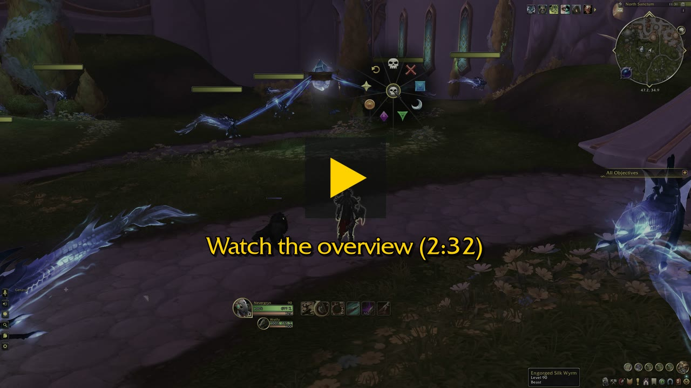](Media/overview.mp4)

## Getting started

1. Open the settings from the minimap's addon drawer, under Esc → Options → AddOns → Radial Menu,
   or with one of these chat commands: `/rm`, `/radial`, or `/radialmenu`.
2. On the `Menus` tab, click `+ New` and set a keybind.
3. Drag spells or items onto the menu, or search with `+`.

> **NOTE**: In WoW Forever's gamepad UI, you can only open the settings from the minimap's addon
> drawer. The other ways can crash the game because of a Blizzard bug.

## Features

### Ping-style menus

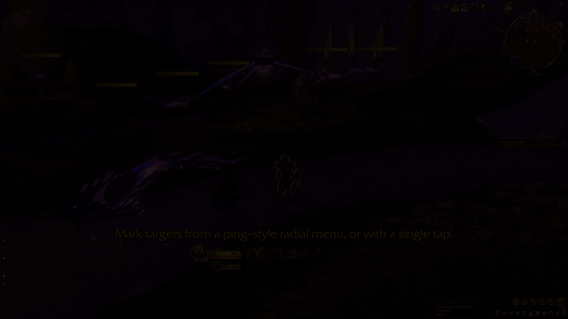

Hold your keybind and the menu opens at your cursor, like the game's ping wheel. Move toward
an action and release to use it. Here, a target marker menu marks the dragonhawks one by one.

The action in the center of the menu is the **quick action**. Press and release the keybind
without moving the cursor, and the quick action is used without the menu appearing. In a marker
menu, the quick action marks the unit under your cursor.

### Any action

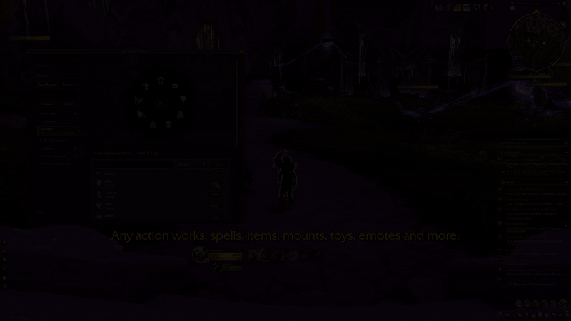

A menu can hold almost anything you can put on an action bar. Here, an emote menu is filled from
the search and then used in game. Each emote gets its own symbol, so the menu is easy to read at a
glance. The full list is in [What a menu can hold](#reference).

### In combat

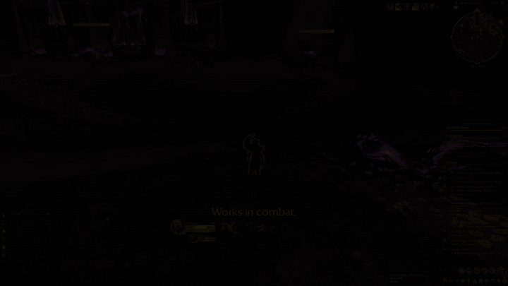

Menus work in combat like any action bar button. Here, a skull goes on the enemy in the middle of
the fight.

Icons show cooldowns, charges, range, procs, and missing resources, just like your action bars.

The game's own combat rules still apply. You cannot change your spec or talents, mount up, or swap
armor in combat.

### Hidden actions

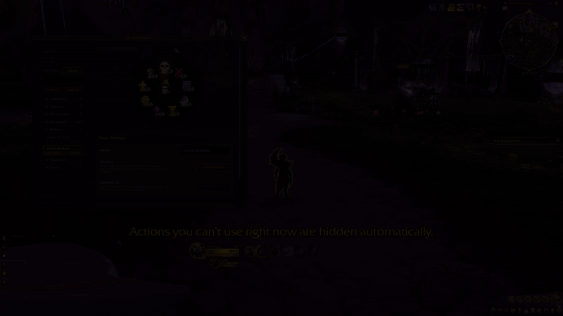

Actions you cannot use right now are left out of the menu, and come back when you can use them
again. Here, the world markers are hidden while not in a group, and another class's spells are
hidden on this character. The eye in the corner of the preview removes the actions that are
currently hidden.

### Special actions

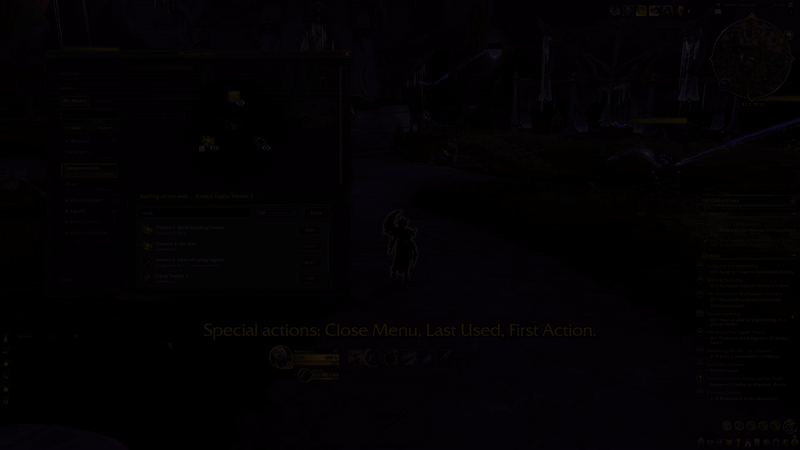

Three special actions do something other than cast.

- The **Close Menu** action closes the menu without using anything.
- The **Last Used Action** repeats what you used last from that menu. It is useful for quest
  items or abilities, or any menu where you tend to use the same action several times in a row.
- The **First Action** uses the first action this character can use. Here, it is the quick action
  of an equipment set menu. The set you are wearing is hidden, so the quick action always puts on
  the other one, and swaps between the two.

These actions work anywhere in the menu, not just as the quick action. To make one the quick
action, double-click the center of the menu in the settings to switch between them, or drag and
drop it there like any other action.

### Submenus

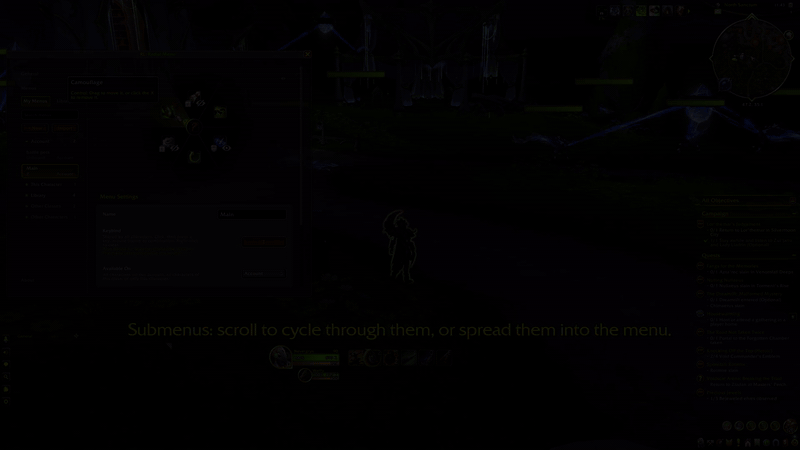

A menu can hold your other menus. Add them from the search using the `Menus` filter.

A submenu shows up as a single action in the menu preview. Hover over it and scroll the mouse
wheel to go through its actions. To see all of the submenu's actions at once instead,
double-click it in the settings to **spread** them into the menu.

Here, a submenu is added, scrolled through in game, then spread.

### Menu position

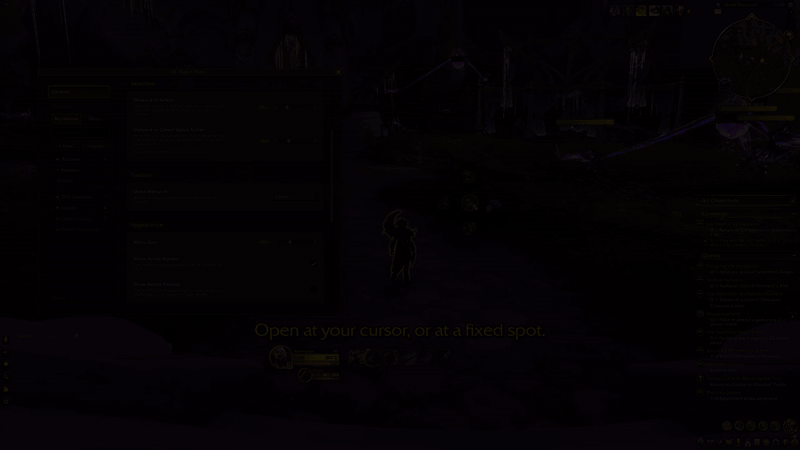

Menus open at your cursor by default. With the `Open Menus At` setting configured to
`Fixed Position`, they open in the same spot on screen every time instead.

A fixed menu also lets you choose how actions are selected, using the `Select From` setting. With
the `Menu Center` option, move your cursor over the menu toward the action you want. With the
`Cursor` option, move your cursor toward the action as if the menu appeared at the cursor. You do
not move your cursor over to the menu.

Here, `Open Menus At` switches from `Cursor` to `Fixed Position`, then `Select From` switches
between `Menu Center` and `Cursor`.

### Edit Mode

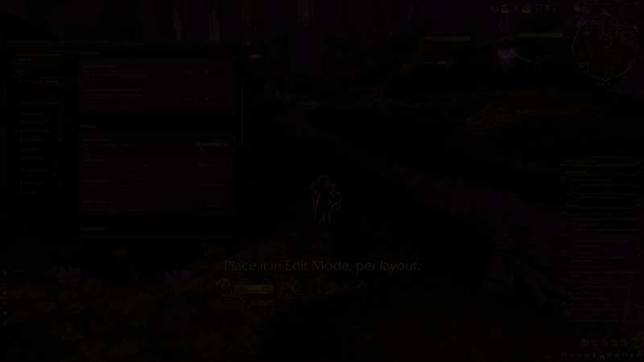

The fixed position is placed in the game's Edit Mode. Here, `Open Edit Mode` shows the
`Radial Menu` box, which is dragged to a new spot and resized. Each Edit Mode layout keeps its own
position.

### Building menus

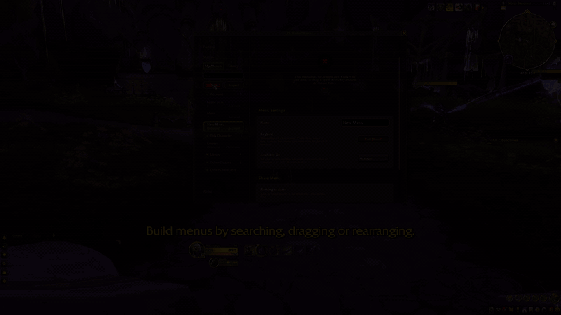

Here, a new mount menu is made for this character only. Mounts are added from the search and
dragged in from the mount journal, then two are swapped by dragging one onto the other. The same
works with spells, items, toys, and macros from your spellbook and bags. Remove an action with
the X on its icon.

### Sharing

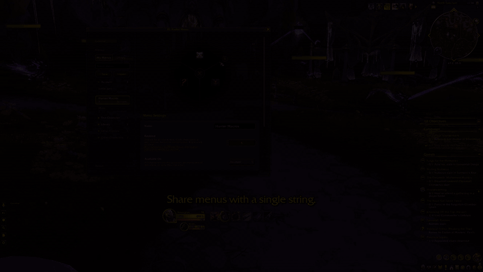

Every menu has a share string under `Share Menu`. Its submenus and macros are included and
listed, so nothing is shared by surprise. It also lists anything that cannot be shared, and why.
Battle pets are tied to your account, for example.

Before anything is added, the import page lists each menu and every macro it will create, with its
text. Importing only adds new menus. It never replaces your existing ones.

Here, a menu of hunter macros is copied with `Share Menu`, then pasted into `Import`.

### Library menus

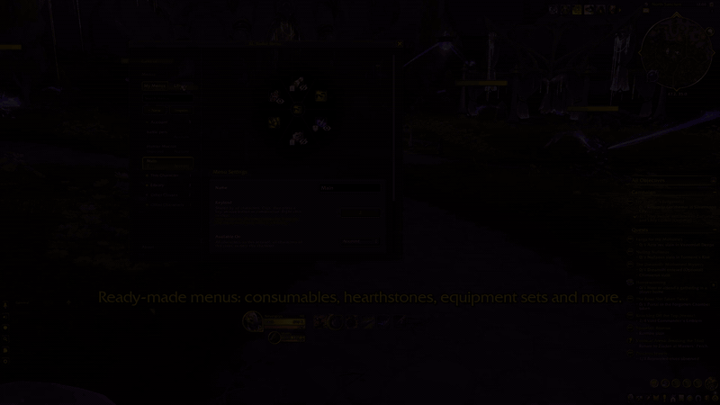

The `Library` has auto-updating, ready-made menus that fill themselves from your bags, spellbook,
and collections. Give one a keybind, or add it to your own menu as a submenu.

You can rearrange the actions in a Library menu and remove the actions you do not need. A removed
action remains removed as the menu updates, but you can restore it from the menu's page. Library
menus themselves cannot be deleted. The full list is in [Library menus](#reference).

Here, the Hearthstones menu is opened and one hearthstone is removed.

### ConsolePort

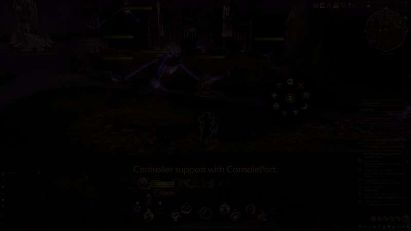

With [ConsolePort](https://www.curseforge.com/wow/addons/console-port), you can use your menus
with a controller. Bind a menu to any controller button or combination, aim with the right stick,
and press **A** to use the action or **B** to close. Scroll submenus with the D-pad.

Creating and editing menus still require a mouse and keyboard. To bind a controller button, click
the menu's `Keybind` and press the button on your controller.

Here, the markers go on the unit ConsolePort is pointing at.

### WoW Forever

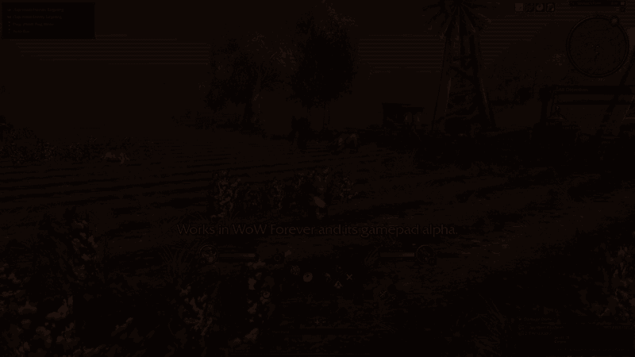

Menus work in WoW Forever too, including its gamepad alpha. A few Retail-only actions and menus
are marked in the tables below.

In the gamepad alpha, creating and editing menus still require a mouse and keyboard. To bind a
controller button, click the menu's `Keybind` and press the button on your controller.

Here, a marker menu is used with WoW Forever's gamepad UI.

## Reference

<b>What a menu can hold</b>

| Action | Description | Shown when | Retail | Forever |
|---|---|---|:---:|:---:|
| Spells | Your spells and pet abilities, including spells from flyouts such as portals and dungeon teleports. In WoW Forever, a specific rank, or always your highest rank. | This character knows the spell. Pet abilities need its pet. | ✓ | ✓ |
| Items | Usable items from your bags. Consumables show how many you have. | This character has at least one in its bags. | ✓ | ✓ |
| Toys | A toy from your Toy Box. | Always | ✓ | ✓ |
| Mounts | A mount from your collection, or a random favorite. | Always | ✓ | ✓ |
| Battle Pets | A companion from your collection, or a random favorite. | Always | ✓ | ✓ |
| Macros | Your account and character macros. | Always | ✓ | ✓ |
| Emotes | Each has its own symbol (silver on Retail, copper on WoW Forever). Similar emotes share one. | Always | ✓ | ✓ |
| Pet Commands | Attack, Follow, Stay, stances, and more. | This character has a pet. | ✓ | ✓ |
| Target Markers | Skull, Cross, and the other target markers, plus one that clears them all. | You can set markers. In a raid, you are the leader or an assistant. | ✓ | ✓ |
| World Markers | Placed on the ground, plus one that clears them all. Each shows a beam of light in its color, so they stand apart from target markers. | You are in a group and can set markers. | ✓ | ✓ |
| Equipped Slot | Uses whatever is equipped in that slot, like trinket 1. | The item there has a use effect. | ✓ | ✓ |
| Equip Item | Equips an item from your bags. In combat, the game only swaps weapons. | This character has one in its bags that it is not wearing. | ✓ | ✓ |
| Equipment Set | Puts on one of your Equipment Manager sets, by name. | This character has a set with that name, and is not wearing it. | ✓ | ✓ |
| Close Menu | Closes the menu without using anything. | Always | ✓ | ✓ |
| Last Used Action | Uses whatever the menu used last. | Always | ✓ | ✓ |
| First Action | Uses the first action this character can use, so one menu can do something different on each character. | Always | ✓ | ✓ |
| Action Bars | A button from one of your action bars (1–8), added as a submenu. Action Bar 1 follows its page, like stances, forms, and stealth. | The button has something on it and the bar is turned on. | ✓ | ✓ |
| Submenus | Another of your menus. | It has at least one action shown. | ✓ | ✓ |
| Zone Ability | The game's Zone Ability button. | There is one. | ✓ | — |
| Extra Action | The Extra Action Button. | There is one. | ✓ | — |
| Housing | Teleport Home to Founder's Point or Razorwind Shores, and Return. | You own a house there. Return shows when the game offers it. | ✓ | — |
| Specializations | Switches to another spec of your class. | It is a spec of this character's class, and not its current one. | ✓ | — |
| Talent Loadouts | Loads a saved build for your current spec. | It is for this character's current spec, and not the active one. | ✓ | — |

<b>Library menus</b>

In the settings, the `Library` tab lists them by category. The ones you bind, or use as submenus
of bound menus, also show under `My Menus`.

| Menu | What it holds | Retail | Forever |
|---|---|:---:|:---:|
| Action Bar 1–8 | The bar's 12 buttons, with empty ones hidden. Add one to a menu as a submenu, then scroll through it or spread it like the bar. | ✓ | ✓ |
| Consumables | Potions, Flasks & Elixirs, Food & Drink, and Other Consumables, as submenus. Each is hidden while you have none of its items. | ✓ | ✓ |
| Equip Head, ..., Equip Main Hand, Equip Off Hand | One per equipment slot, with the items in your bags you can equip there. In combat, the game only swaps weapons. The search lists them under the `Equipment` filter, to add as submenus. | ✓ | ✓ |
| Equip Ranged & Relics | Ranged weapons and relics (librams, idols, and totems) in your bags, to equip. | — | ✓ |
| Equipment Sets | Your Equipment Manager sets, except the one you are wearing. | ✓ | ✓ |
| Flasks & Elixirs | Flasks, phials, and elixirs in your bags. | ✓ | ✓ |
| Food & Drink | Food and drink in your bags. | ✓ | ✓ |
| Hearthstones | Your Hearthstone, the hearthstone toys you own, Teleport Home to your houses, and Return. | ✓ | — |
| Other Consumables | Bandages, scrolls, explosives and devices, item enhancements, and Vantus runes in your bags. On Retail, also weapon oils and stones, augment runes, curios, and other usable consumables. | ✓ | ✓ |
| Potions | Potions and Healthstones in your bags. | ✓ | ✓ |
| Professions | Your professions, which open their window, and their extra spells, like Disenchant, Prospecting, Survey, and Fishing. | ✓ | ✓ |
| Quest Items | The item buttons from your quest log, plus usable quest items and quest starters in your bags. In WoW Forever, only your bags. Quest abilities are in Zone and Extra. | ✓ | ✓ |
| Season Teleports | The current Mythic+ season's dungeon teleports you have earned. | ✓ | — |
| Specializations | The specs of your class you can switch to. | ✓ | — |
| Talent Loadouts | Your current spec's saved builds, except the active one. | ✓ | — |
| Target Markers | All eight target markers, plus one that clears them all. | ✓ | ✓ |
| Trinkets & On-Use | Every equipped item with a use effect. | ✓ | ✓ |
| World Markers | All eight world markers, plus one that clears them all. | ✓ | ✓ |
| Zone and Extra | The Zone Ability and the Extra Action Button. | ✓ | — |

<b>Settings</b>

Everything is in `/radial` (also under Options → AddOns). The tables below follow the `General`
tab from top to bottom. Some settings only show when they apply, like the mouse settings while you
play with a controller (WoW Forever's gamepad UI, or ConsolePort).

**Style**

| Setting | Option | Default | What it does | Shown when |
|---|---|---|---|---|
| `Menu Style` | `Quick` | Default | Hold the keybind, move toward an action, and release to use it. | Mouse and keyboard |
|  | `Relaxed` |  | Press the keybind and the menu opens and stays open. Click an action to use it. | Mouse and keyboard |
| `Flick to Select` | On or off | Off | Push the right stick toward an action and let go to use it, without pressing A. With ConsolePort, this needs its Allow Radial Bindings option, in its advanced settings. | Controller |
| `Reveal Delay` | Seconds | 0.15 | How long you hold the keybind before the menu appears. Release sooner to use the quick action without the menu showing. | `Menu Style` is `Quick` |
| `Right-Click to Cancel` | On or off | On | While a menu is open, right-click closes it without using anything. | Mouse and keyboard |

**Selection**

| Setting | Option | Default | What it does | Shown when |
|---|---|---|---|---|
| `Distance to Select` | Pixels | 24 | How far to move the cursor before an action is selected. | Mouse and keyboard |
| `Distance to Cancel Quick Action` | Pixels | 12 | How far you move the cursor from where you pressed the keybind before the quick action is dismissed. | Mouse and keyboard |

**Position**

| Setting | Option | Default | What it does | Shown when |
|---|---|---|---|---|
| `Open Menus At` | `Cursor` | Default | Menus open at your cursor. | Always |
|  | `Fixed Position` |  | Menus open in the same spot every time, which you place in Edit Mode. | Always |
| `Select From` | `Cursor` |  | Actions are selected by the direction you move from where you pressed the keybind. | `Fixed Position`, mouse and keyboard |
|  | `Menu Center` | Default | Actions are selected by where your cursor is over the menu. | `Fixed Position`, mouse and keyboard |
| `Menu Position` | `Open Edit Mode` |  | Move the menu in Edit Mode. The position is saved per Edit Mode layout. | `Fixed Position` |
| `Reset Position` | Button |  | Moves the menu back to the center of the screen, for the current Edit Mode layout. | `Fixed Position` |

**Appearance**

| Setting | Option | Default | What it does | Shown when |
|---|---|---|---|---|
| `Menu Size` | Percent | 100% | Size of the menu on screen. | Always |
| `Show Action Names` | On or off | On | The name of the selected action, beside its icon. | Always |
| `Show Action Tooltips` | On or off | Off | The tooltip of the selected action, where your HUD Tooltip is placed in Edit Mode. | Always |
| `Show Cursor Guide` | On or off | Off | A faint outline of the menu is drawn at your cursor, to show where each action is. | `Select From` is `Cursor`, mouse and keyboard |
| `Cursor Guide Color` | Color | White | The color of the guide's lines. They stay faint, and brighten for the action you are pointing at. | `Show Cursor Guide` is on |

**Markers**

| Setting | Option | Default | What it does | Shown when |
|---|---|---|---|---|
| `Place World Markers` | `Cursor` | Default | World markers go on the ground under your cursor when you release. | Not in WoW Forever's gamepad UI |
|  | `Click to Place` |  | World markers give you a targeting circle. Click the ground to place the marker. | Not in WoW Forever's gamepad UI |
| `Mark Target Markers On` | `Your Target` |  | Target markers go on your target. | Not with ConsolePort |
|  | `Cursor` | Default | Target markers go on the unit under your cursor when you press the keybind, or on your target if there is none. The quick action works on any unit, but wheel actions need a visible nameplate, and go on your target in combat. In WoW Forever's gamepad UI, this is `Reticle`. | Not with ConsolePort |
|  | `Cursor + Focus` |  | Like `Cursor`, but in menus of only target markers, wheel actions work on any unit, even in combat. To do this, the unit becomes your focus while the menu is open, replacing your current focus. In WoW Forever's gamepad UI, this is `Reticle + Focus`. | Not with ConsolePort |
|  | `Your Target` |  | Target markers go on your target. | With ConsolePort |
|  | `Soft Target` | Default | Target markers go on the unit ConsolePort is pointing at when you pick them, or on your target if there is none. | With ConsolePort |

**Reset**

| Setting | Option | Default | What it does | Shown when |
|---|---|---|---|---|
| `Reset to default` | Button |  | Resets settings only. Your menus are kept. | Always |

In the `Menus` tab, each menu has a name, a `Keybind`, `Available On` (all your characters, the
characters of your class, or just this one), and its `Share Menu` string. In the menu preview:

- Drag any action to the center to make it the quick action, or double-click the center to switch
  between Close Menu, Last Used Action, and First Action.
- Double-click a submenu to switch between scrolling and spreading it.
- The eye in the corner hides actions that are hidden in game right now.

In combat, menus keep the actions they had when combat started, and update once it ends. Changes
to your menus and settings also wait until combat ends.

## Credits and license

RL: Radial Menu is free software under the **GNU General Public License v3** (see `LICENSE` and
`NOTICE`).

- The settings window and its UI toolkit (`libs\AX_Settings`, `libs\AX_Modules`) are based on
  **WaypointUI** by **AdaptiveX** (GPLv3).
- Aiming with the right stick without turning the camera (WoW Forever's gamepad UI) follows the
  technique in **ConsolePort** by **Sebastian Lindfors** (Artistic License 2.0).
- Emote symbols (`Art\Symbols`) from [game-icons.net](https://game-icons.net) by Lorc, Delapouite,
  Caro Asercion, and Cathelineau, under [CC BY 3.0](https://creativecommons.org/licenses/by/3.0/)
  (not the GPL), converted to PNG and recolored. Each symbol's artist is in
  [Art/Symbols/CREDITS.md](Art/Symbols/CREDITS.md).
- The menu's look follows Blizzard's ping wheel.
